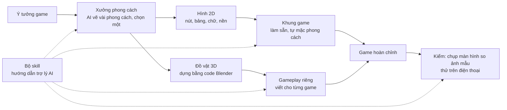
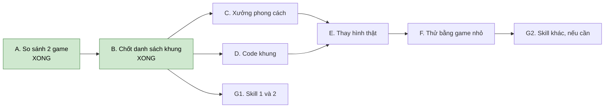

# Kế hoạch: bộ công cụ làm game nhanh (cập nhật 2026-11-11)

Khi có ý tưởng game mới, người làm game chỉ cần nghĩ gameplay. Phần xung quanh và hình ảnh được làm sẵn. Các game làm sau chủ yếu thuộc thể loại hybrid-casual, nên phần khung gần như không đổi giữa các game. Chi tiết kỹ thuật (spec) viết sau.

## Bộ công cụ làm việc thế nào

Khung dùng được cho cả game 2D lẫn 3D vì giao diện luôn là lớp 2D. Hình không gắn cứng vào khung, nên viết code khung trước với hình tạm rồi thay hình thật sau.

## Khung game gồm những gì

| Nền tảng và dữ liệu | Màn hình | Bảng thông báo |
|---|---|---|
| Lưu dữ liệu | Màn hình chính | Thắng |
| Vàng, tim, booster | Cửa hàng | Thua |
| Âm thanh | Điểm danh ngày | Hồi sinh |
| Rung | Nhiệm vụ ngày | Tạm dừng |
| Cài đặt | Bảng xếp hạng (Unity Leaderboards) | Rời ván |
| Đa ngôn ngữ | Màn hình tải | |
| Vùng an toàn (tai thỏ) | | |
| Xem quảng cáo nhận thưởng (giả) | | |
| Mua hàng (giả) | | |
| Thông báo đẩy | | |
| Cấu hình từ xa | | |

Chưa đưa vào khung (mới thấy ở một game): hồ sơ người chơi, chọn booster trước ván, nhiệm vụ sự kiện, ưu đãi xoay vòng, Sky Jump. Sẽ cân nhắc khi lặp lại ở game thứ ba.

## Bộ skill
Skill là hướng dẫn ngắn cho trợ lý AI, chỉ được mở ra khi việc đang làm khớp. Làm trước hai skill có bằng chứng rõ từ hai game đã làm:

| Skill | Làm gì |
|---|---|
| Làm việc với AI | Đầu phiên đọc gì, giao việc, canh việc chạy nền, ghi bài học ngay lúc gặp lỗi |
| Kiểm tra kết quả | Kiểm tra tự động, chụp màn hình so ảnh mẫu, thử điện thoại; chưa kiểm thì không báo xong |

Các skill khác (hình ảnh, đồ vật 3D, gameplay...) chỉ làm khi có đủ bài học nguồn và sau khi đã dùng thật hai skill đầu.

## Các bước xây

| Bước | Việc | Xong khi |
|---|---|---|
| A | So sánh phần xung quanh của hai game đã làm | Có bảng từng chức năng, kiểm lại ngẫu nhiên |
| B | Chốt danh sách đưa vào khung | Danh sách được duyệt |
| C | Xưởng phong cách | Thử với một ý tưởng giả: ra 3-4 phong cách, chọn một, ra đủ bộ hình đồng nhất, dựng thử một đồ vật 3D |
| D | Code khung, các màn hình dùng hình tạm | Chạy đúng, có kiểm tra tự động, chạy được trên điện thoại |
| E | Thay hình tạm bằng hình của xưởng | Mỗi màn hình đúng ảnh mẫu đã duyệt, ở 2 kiểu màn hình |
| F | Thử bằng một game mới nhỏ (3 màn) | Chạy trên điện thoại, ghi số giờ thật để biết tiết kiệm bao nhiêu |
| G1 | Viết skill 1 và 2 | Qua thử nghiệm: nên dùng, không nên dùng, so với không có skill |
| G2 | Viết thêm skill khác, nếu cần | Như G1, sau khi hai skill đầu đã dùng thật |
